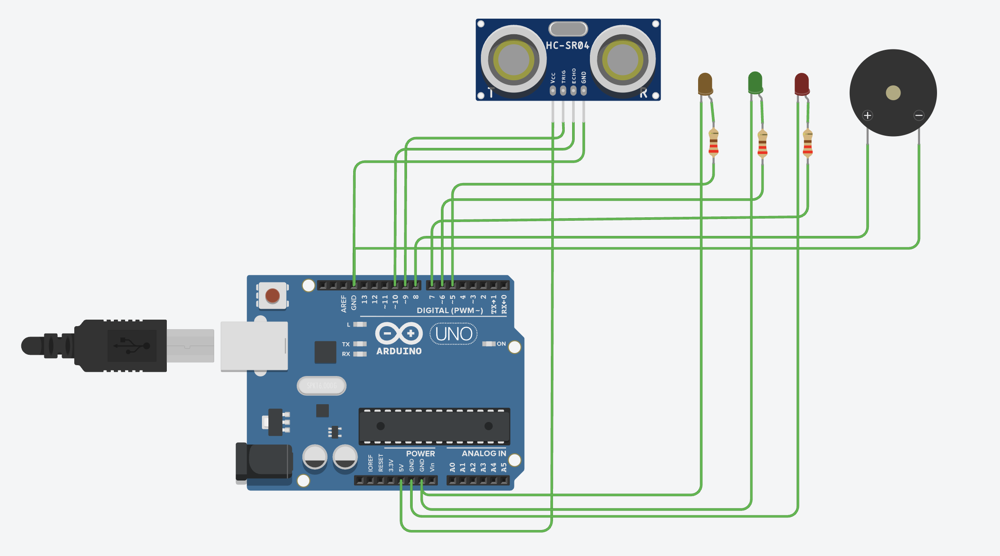
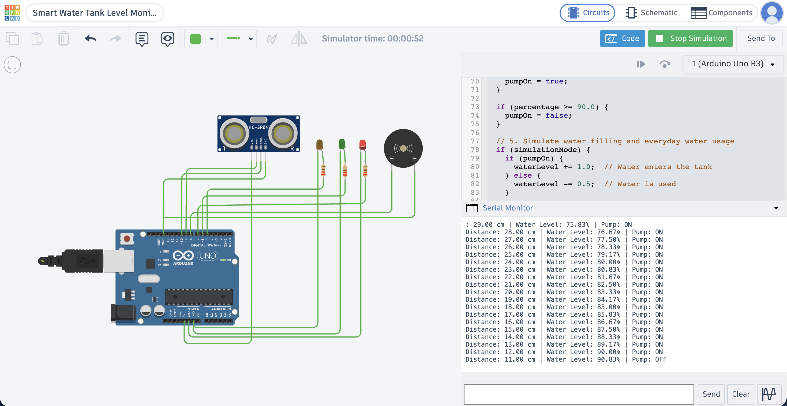

# Smart Water Tank Level Monitoring and Overflow Prevention

An Arduino-based project that monitors water levels and demonstrates automatic pump control and overflow alerts using an HC-SR04 ultrasonic sensor, LEDs, and a buzzer.



## Project Demonstration

### 1. Tank Filling

The simulated water level increases while the pump is ON. As the tank approaches 90% capacity, the pump automatically turns OFF to prevent overflow.


### 2. Tank Draining and Automatic Refilling

When the pump is OFF, the simulation decreases the water level to represent water usage. When the level reaches 20% or below, the pump turns ON again.


### 3. Overflow Prevention

At 90% water level, the pump turns OFF and the buzzer activates to warn that the tank is nearly full. The red LED indicates a high water level.



## Features

- 120 cm tank-height configuration
- Ultrasonic distance calculation
- Automatic pump-control logic
- Pump ON at or below 20%
- Pump OFF at or above 90%
- Green and red level indicators
- Buzzer alarm at or above 90%
- Simulation mode for automatic filling and draining
- Serial Monitor output for distance, water level, and pump status
- Actual HC-SR04 sensor mode for physical measurements

## Components

- Arduino Uno R3
- HC-SR04 ultrasonic sensor
- Three LEDs and 220-ohm resistors
- Piezo buzzer
- Breadboard and jumper wires

For a physical pump, a suitable relay or MOSFET driver, a separate power supply, and a compatible low-voltage DC pump are also required.

## Circuit Connections

| Component | Arduino connection |
|---|---|
| HC-SR04 VCC | 5V |
| HC-SR04 GND | GND |
| HC-SR04 TRIG | D9 |
| HC-SR04 ECHO | D10 |
| Pump status LED | D5 |
| Green LED | D6 |
| Red LED | D7 |
| Buzzer positive | D8 |
| LED cathodes | GND |
| Buzzer negative | GND |

Connect each LED through a 220-ohm resistor.

## How It Works

### 1. Distance Measurement

The HC-SR04 sends an ultrasonic pulse toward the water surface and measures the time taken for the echo to return.

The distance is calculated using:

```cpp
float distance = duration * 0.0343 / 2.0;
```

Here:
- `duration` is the echo travel time in microseconds.
- `0.0343` is the approximate speed of sound in centimetres per microsecond.
- Division by `2.0` accounts for the sound travelling to the water and back.

### 2. Water-Level Calculation

The configured tank height is 120 cm.

```cpp
waterLevel = tankHeight - distance;
percentage = (waterLevel / tankHeight) * 100.0;
```

The tank height must match the actual vertical distance from the sensor's measuring face to the tank bottom when the tank is empty.

### 3. Automatic Pump Control

| Water level | Pump status | Alarm |
|---|---|---|
| 20% or below | ON | OFF |
| Between 20% and 90% | Maintains previous state | OFF |
| 90% or above | OFF | ON |

The program uses **hysteresis**: separate thresholds for starting and stopping the pump. This prevents the pump from repeatedly switching on and off around a single threshold.

The green LED indicates levels below 80%, while the red LED indicates levels of 80% or above.

## Simulation and Real Hardware

The program supports two operating modes controlled by the `simulationMode` variable.

### Simulation Mode

```cpp
const bool simulationMode = true;
```

In this mode, the program simulates water filling while the pump is ON and water usage while the pump is OFF.

It calculates a virtual sensor distance from the simulated water level and uses the ultrasonic distance formula to demonstrate the control logic.

**Important:** The distance in simulation mode is calculated in software. It is not measured from a changing physical water surface.

### Actual Sensor Mode

```cpp
const bool simulationMode = false;
```

In this mode, the program triggers the HC-SR04, measures the echo duration, and calculates the actual distance and water level.

The program does not artificially increase or decrease the water level in this mode. Water movement must happen physically, or the sensor's simulated target must be adjusted in Tinkercad.

Tinkercad does not automatically connect the software-based filling simulation to the HC-SR04's virtual target.

## Running the Project in Tinkercad

1. Create an Arduino Uno circuit in Tinkercad Circuits.
2. Connect the components according to the wiring table.
3. Copy `smart_water_tank.ino` into the Arduino code editor.
4. Set `simulationMode` to `true`.
5. Start the simulation and open the Serial Monitor.
6. Observe the simulated water level, calculated distance, pump status, LEDs, and buzzer.

## Physical Prototype and Safety

The pump LED in this project indicates the desired pump state; it does not power a real pump.

To operate a physical pump:
- Use a suitably rated relay or MOSFET driver.
- Use a separate power supply appropriate for the pump.
- Keep the Arduino and electrical connections away from water.
- Add independent overflow protection and a pump timeout.
- Test sensor failures and pump switching before unattended use.

Never connect a pump directly to an Arduino GPIO pin.

## Technologies Used

- Arduino C++
- HC-SR04 ultrasonic sensing
- Embedded systems
- Tinkercad Circuits

## Future Improvements

- Add an LCD or OLED to display the water level.
- Add Wi-Fi-based monitoring and notifications.
- Add an independent high-level sensor for backup overflow protection.
- Test and calibrate the system with a physical tank and pump.
